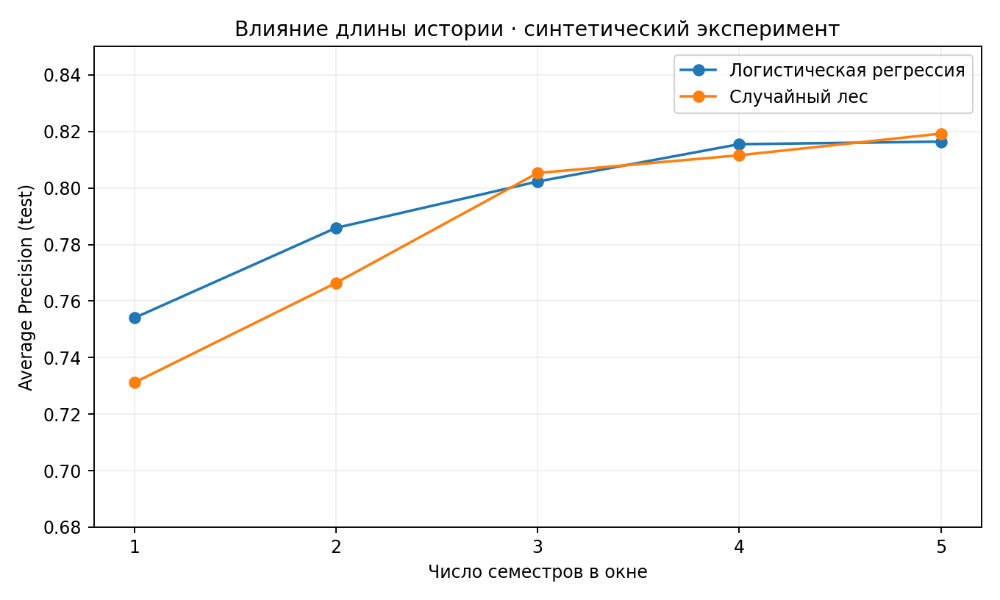
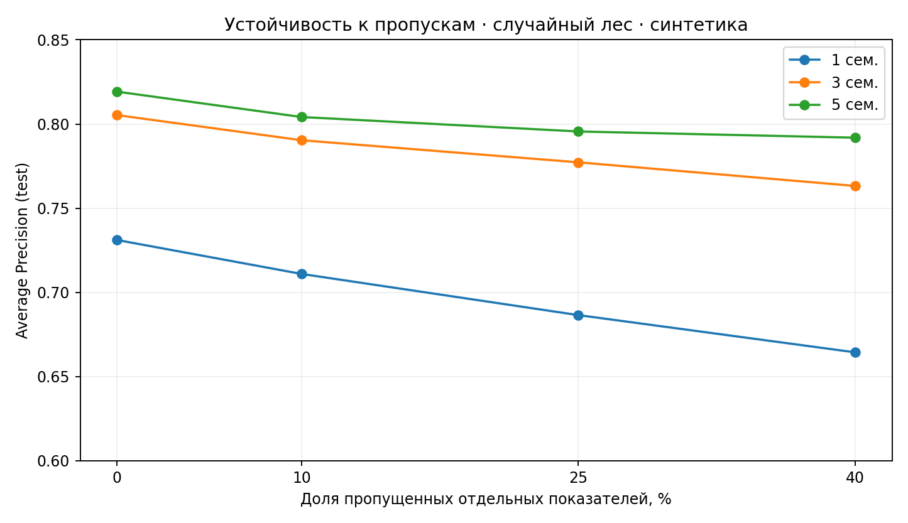

# Отчёт об эксперименте v0.3 (синтетическая демонстрация)

**Тема:** влияние длины истории успеваемости и пропущенных измерений на качество прогноза.
**Источник данных:** искусственно сгенерированные записи, 420 студентов, 10 смоделированных семестров.

**Значение для диссертации:** этап проверки методики и отбора направлений исследования,
не доказательство научной новизны и не оценка работы на настоящих образовательных данных.

## Сравнение по длине истории без искусственных пропусков

| Семестров | AP логистическая | AP лес | Brier логистическая | Brier лес |
|---:|---:|---:|---:|---:|
| 1 | 0.754 | 0.731 | 0.150 | 0.154 |
| 2 | 0.786 | 0.766 | 0.139 | 0.142 |
| 3 | 0.802 | 0.805 | 0.134 | 0.131 |
| 4 | 0.815 | 0.812 | 0.130 | 0.129 |
| 5 | 0.816 | 0.819 | 0.129 | 0.127 |

Для примера на синтетических тестовых данных увеличение окна от 1 до 5 семестров
повысило AP логистической регрессии с 0,754 до 0,816, случайного леса — с 0,731 до 0,819.
Эффект зависит от выбранного генератора данных, не подлежит переносу на реальные наблюдения без отдельной проверки.

## Сценарии с 25% пропусков

| Модель | Механизм | AP: 1 семестр | AP: 3 семестра | AP: 5 семестров | Лучшее окно по validation |
|---|---|---:|---:|---:|---:|
| Логистическая | mcar_cells | 0.711 | 0.771 | 0.802 | 5 |
| Случайный лес | mcar_cells | 0.687 | 0.777 | 0.796 | 3 |
| Логистическая | blocked_terms | 0.691 | 0.788 | 0.809 | 5 |
| Случайный лес | blocked_terms | 0.667 | 0.786 | 0.804 | 5 |

При 25% независимо пропущенных измерений случайный лес по validation выбрал окно
в 3 семестра (AP test 0,777); тестовое AP для 5 семестров 0,796.
Выбирать окно 5 только потому, что тестовый показатель выше, **нельзя**:
это означало бы настройку по отложенной выборке.

## Выбор длины истории по валидации

| Пропуски | Семейство | Окно (val) | AP тест выбранное | AP тест срез (1) | Δ AP |
|---|---|---:|---:|---:|---:|
| без пропусков | Логистическая | 5 | 0.816 | 0.754 | +0.062 |
| без пропусков | Случайный лес | 5 | 0.819 | 0.731 | +0.088 |
| mcar_cells, 25% | Логистическая | 5 | 0.802 | 0.711 | +0.091 |
| mcar_cells, 25% | Случайный лес | 3 | 0.777 | 0.687 | +0.091 |
| blocked_terms, 25% | Логистическая | 5 | 0.809 | 0.691 | +0.118 |
| blocked_terms, 25% | Случайный лес | 5 | 0.804 | 0.667 | +0.137 |
| blocked_terms, 40% | Логистическая | 5 | 0.809 | 0.644 | +0.165 |
| blocked_terms, 40% | Случайный лес | 5 | 0.804 | 0.615 | +0.189 |

## Интерпретация

На смоделированных данных многосеместровые признаки ассоциированы с улучшением AP
и часто меньшим значением Brier score. Повторения с разными масками демонстрируют
чувствительность к типу и уровню пропусков. В некоторых режимах критерий validation
выбирает не максимальную длину окна. Это мотивирует исследование алгоритма
адаптации длины истории под доступный массив наблюдений.

## Методологические ограничения

1. Все числа относятся только к одной синтетической генеративной модели.
2. Прогнозируется следующий семестр после завершения текущего.
3. Случайная потеря целого семестра не равна реалистичному механизму MAR/MNAR.
4. Три маски пропусков не образуют независимых когорт, стандартное отклонение по маскам не является доверительным интервалом.
5. Студенты повторяются по временным срезам; не проверялась переносимость на новые группы.
6. Для утверждения научной новизны нужен поиск аналогов, обоснование собственного метода, независимая проверка и сравнение.

## Следующий шаг

Сформировать формальную постановку алгоритма **адаптивного окна истории**, который оценивает качество
и полноту предыдущих наблюдений до момента прогноза и выбирает длину окна без доступа к будущим значениям.
Сравнить с оптимизированными фиксированными окнами на независимых по времени и когортам данных.

## Воспроизводимость

Конфигурация, точные маски, предсказательные признаки и все 190 оценок доступны в `reports/ablation_*_synthetic.*`.
Протокол эксперимента: `research/07_window_missingness_protocol_v03.md`.
Запуск: `python -m edurisk.ablation --input data/synthetic_long_10_terms.csv --output reports`.
