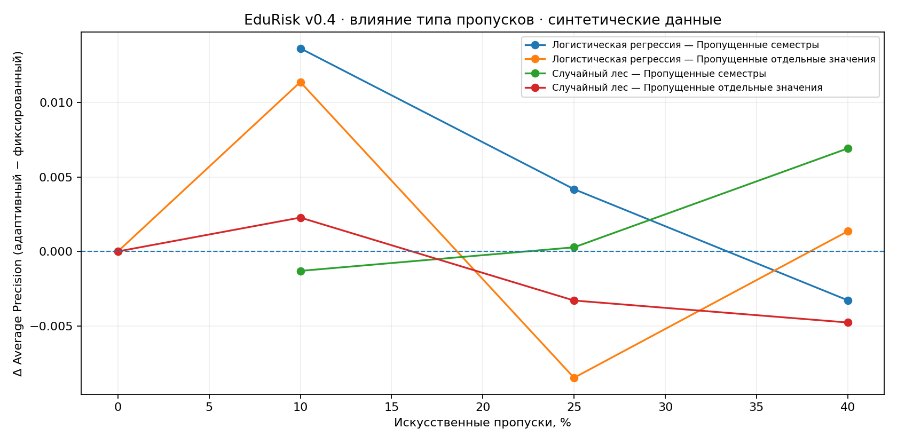
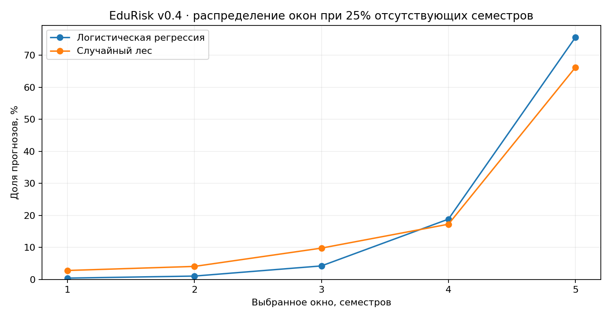

# EduRisk v0.4: эксперимент с адаптивной длиной истории

**Статус:** завершённый воспроизводимый эксперимент на *синтетических* данных (не на реальных студентах).  
**Научная специальность:** 1.2.1 «Искусственный интеллект и машинное обучение».  
**Тема:** «Модели и алгоритмы мониторинга и прогнозирования академической успеваемости обучающихся для поддержки принятия решений в образовательном процессе».

## Цель

Разработать правило индивидуального выбора длины истории на основе полноты и изменчивости измерений и сравнить его с единым фиксированным окном, выбранным по validation. Формальная постановка: `research/10_adaptive_mathematical_model_v04.md`.

## Дизайн

- **420** синтетических студентов, **10** семестров; **3 780** строк с меткой следующего семестра; обучение на t=5–7 (**1260** наблюдений), validation на t=8 (**420**), test на t=9 (**420**).
- Окна 1–5; доли пропусков 0%, 10%, 25%, 40%; два механизма (случайные значения и целые отсутствующие семестры), три маски при ненулевом уровне.
- Модели: логистическая регрессия и случайный лес; всего **190 обучений** базовых моделей и **12 конфигураций гейта**, исследованных на validation. Контрольные фиксированные прогнозы **численно совпали с v0.3** по AP/Brier.
- Лучший фиксированный вариант и конфигурация гейта отбирались **только на validation**, отдельно для каждой экспериментально известной комбинации механизма/уровня пропусков/семейства модели. На test гиперпараметры не подбирались.
- Метрики: Average Precision (основная), ROC-AUC, Brier. В таблице показана средняя разность AP по парным маскам, не доверительные интервалы.

## Полное сравнение на test

| Тип пропусков | Базовая модель | Доля | AP: фиксированное окно | AP: адаптивный выбор | Δ AP |
|---|---|---:|---:|---:|---:|
| Пропущенные семестры | Логистическая регрессия | 10% | 0.7964 | 0.8100 | +0.0136 |
| Пропущенные семестры | Случайный лес | 10% | 0.8107 | 0.8094 | -0.0013 |
| Пропущенные семестры | Логистическая регрессия | 25% | 0.8089 | 0.8131 | +0.0042 |
| Пропущенные семестры | Случайный лес | 25% | 0.8040 | 0.8043 | +0.0003 |
| Пропущенные семестры | Логистическая регрессия | 40% | 0.8087 | 0.8054 | -0.0033 |
| Пропущенные семестры | Случайный лес | 40% | 0.8039 | 0.8108 | +0.0069 |
| Пропущенные отдельные значения | Логистическая регрессия | 0% | 0.8164 | 0.8164 | +0.0000 |
| Пропущенные отдельные значения | Случайный лес | 0% | 0.8192 | 0.8192 | +0.0000 |
| Пропущенные отдельные значения | Логистическая регрессия | 10% | 0.7992 | 0.8105 | +0.0114 |
| Пропущенные отдельные значения | Случайный лес | 10% | 0.8042 | 0.8064 | +0.0023 |
| Пропущенные отдельные значения | Логистическая регрессия | 25% | 0.8019 | 0.7934 | -0.0085 |
| Пропущенные отдельные значения | Случайный лес | 25% | 0.7773 | 0.7740 | -0.0033 |
| Пропущенные отдельные значения | Логистическая регрессия | 40% | 0.7911 | 0.7925 | +0.0014 |
| Пропущенные отдельные значения | Случайный лес | 40% | 0.7919 | 0.7871 | -0.0048 |

Из **14** сравниваемых комбинаций: **7** имеют положительную разность AP, **5** — отрицательную, **2** совпали. Следовательно, **устойчивого преимущества адаптивного правила во всех сценариях нет**. Особенно показательна отрицательная разница у логистической регрессии при 25% пропусков отдельных измерений — результат не следует скрывать.



## Выбранные параметры (только по validation)

| Тип пропусков | Модель | Доля | Выбранное фиксированное k | Выбранная конфигурация гейта |
|---|---|---:|---:|---|
| Пропущенные семестры | Логистическая регрессия | 10% | 3 | `c0_v0_p0.8` |
| Пропущенные семестры | Случайный лес | 10% | 5 | `c0.5_v0_p0.25` |
| Пропущенные семестры | Логистическая регрессия | 25% | 5 | `c0_v0.3_p0.25` |
| Пропущенные семестры | Случайный лес | 25% | 5 | `c0.5_v0.3_p0.25` |
| Пропущенные семестры | Логистическая регрессия | 40% | 5 | `c0_v0.3_p0.25` |
| Пропущенные семестры | Случайный лес | 40% | 5 | `c0_v0.3_p0.25` |
| Пропущенные отдельные значения | Логистическая регрессия | 0% | 5 | `c0.5_v0.3_p0.25` |
| Пропущенные отдельные значения | Случайный лес | 0% | 5 | `c0.5_v0.3_p0.25` |
| Пропущенные отдельные значения | Логистическая регрессия | 10% | 3 | `c0.5_v0.3_p0.8` |
| Пропущенные отдельные значения | Случайный лес | 10% | 5 | `c0.5_v0.3_p0.25` |
| Пропущенные отдельные значения | Логистическая регрессия | 25% | 5 | `c0_v0.3_p0.8` |
| Пропущенные отдельные значения | Случайный лес | 25% | 3 | `c0.5_v0_p0.8` |
| Пропущенные отдельные значения | Логистическая регрессия | 40% | 5 | `c0_v0.3_p0.25` |
| Пропущенные отдельные значения | Случайный лес | 40% | 5 | `c0.5_v0.3_p0.25` |

Конфигурация `c0.5_v0.3_p0.8` означает веса $\alpha=0.5$, $\beta=0.3$, $\gamma=0.8$ в формуле качества окна. См. файл математической постановки.



## Научная интерпретация и ограничения

**Установлено на уровне синтетической симуляции:** построена исполнимая схема индивидуального выбора окна; обеспечена воспроизводимость прежних моделей; показано, что эффект от адаптивности зависит от типа и доли пропусков и семейства модели. Это экспериментальная демонстрация, **не доказательство научной новизны, реального прогностического эффекта или причинности**.

**Что нельзя утверждать:** что алгоритм всегда лучше, что распределение ошибок соответствует реальным университетам, что найденные веса оптимальны для новых когорт или что три повторные маски представляют три независимые выборки.

**Потенциальные уязвимости:** подбор конфигурации на одном validation-семестре; преимущество экспериментатора, знающего долю и тип пропусков; модель генерации, задающая синтетические временные зависимости; непроверенная переносимость на новых обучающихся и реальную MAR/MNAR неполноту; отсутствие независимых повторов синтетических когорт.

## Предлагаемая следующая проверка

1. Провести **nested/rolling-origin** оценку с внешними временными блоками, на каждом блоке переобучать гейт и базовые модели только на прошлом.
2. Сравнить с более сильными конкурентами: фиксированное k=5, validation-selected k, простая смесь прогнозов, вариант с индикаторами пропусков, взвешенное усреднение без отдельного выбора k.
3. Повторить эксперимент на множестве **независимых синтетических когорт**, а затем на законно полученных обезличенных реальных данных и отдельно на новых программах/группах.
4. Изучить калибровку (Brier, calibration curves), устойчивость к нерегулярной истории и потерям MAR/MNAR; оценивать разности с учётом группирования по студентам.
5. Выполнить систематический обзор аналогичных адаптивных алгоритмов прежде, чем формулировать положение научной новизны.

## Файлы для воспроизведения

- `src/edurisk/adaptive.py` — алгоритм и экспериментальный цикл.
- `reports/adaptive_all_candidates_synthetic.csv` — валидированные 12 гейтов и пять фиксированных окон по каждой маске.
- `reports/adaptive_selections_synthetic.csv` — глобальные настройки, отобранные на validation.
- `reports/adaptive_test_comparison_synthetic.csv` — результаты test на каждом seed.
- `reports/adaptive_comparison_synthetic.csv` — агрегаты и парные разности.
- `reports/adaptive_window_usage_synthetic.csv` — частоты выборов k.
- `reports/adaptive_summary_synthetic.json` — метаданные, сетка и методологические ограничения.
- `reports/adaptive_delta_ap_synthetic.png`, `reports/adaptive_selected_windows_synthetic.png` — графики.

Команды:

```powershell
$env:PYTHONPATH = 'src'
python -m edurisk.adaptive --input data/synthetic_long_10_terms.csv --output reports
python make_report_v04.py
pytest -q
```
